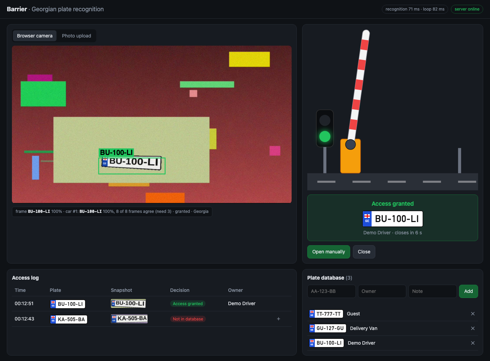
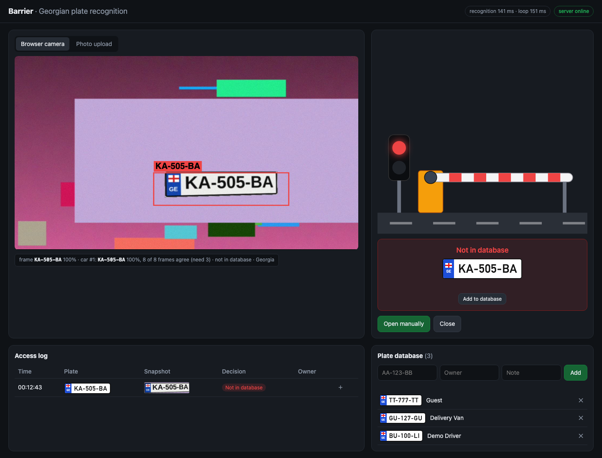

# Plate Barrier

Georgian licence-plate recognition with a web UI and a virtual barrier.
A camera frame goes through plate detection and OCR, the plate is checked against a database,
and the barrier opens for allowed cars. Runs in Docker on CPU, offline (models are baked into the image).

| Allowed car | Unknown car |
|---|---|
|  |  |

## Quick start

```bash
docker compose up -d --build
open http://localhost:8765        # allow camera access in the browser
```

- **Browser camera**: the page sends frames from the laptop/webcam to the server.
  Browsers only allow the camera on `http://localhost` or HTTPS.
- **Photo upload**: drop a photo of a car; decided from a single frame.
- **Server camera**: set `CAMERA_SOURCE` (USB `/dev/video0` or `rtsp://…`) and the server reads
  the stream itself. This is the mode for a real installation, see [docs/HARDWARE.md](docs/HARDWARE.md).

## How it works

```
frame ─► YOLOv9 plate detector ─► OCR (probabilities per character slot)
      ─► decode against template AA-123-BB ─► track the plate across frames ─► vote ─► decision
```

- **Detector / OCR**: [fast-alpr](https://github.com/ankandrew/fast-alpr): `yolo-v9-t-512` and
  `cct-s-v2-global` (ONNX, CPU). The OCR also predicts the country, e.g. `Georgia`.
- **Template decoding** ([app/plates.py](app/plates.py)): a letter slot takes the most likely *letter*,
  a digit slot the most likely *digit*, and the plate's confidence is its weakest character.
  A character the OCR emits twice (`NO7177AH`, `AHH`) can be skipped once, with a penalty.
- **Voting** ([app/gate.py](app/gate.py)): each detection is linked to a track (one car).
  A decision is made once per car, when at least `MIN_AGREE` frames independently read the same plate
  and it holds at least `AGREE_SHARE` of the votes. Misreads while the car approaches never reach the log.
- **Storage**: SQLite in the `barrier-data` volume: allowed plates, access log with a plate snapshot.

## Logs

One line per decision; HTTP access logs are off.

```
INFO app: ALPR models loaded in 0.1s
INFO:     Uvicorn running on http://0.0.0.0:8080 (Press CTRL+C to quit)
INFO gate: car #1 KA-505-BA DENIED | 3 of 3 frames agree, conf 1.00, source browser-camera, event 1
INFO gate: car #1 BU-100-LI GRANTED (Demo Driver) | 5 of 8 frames agree, conf 1.00, source browser-camera, event 2
INFO gate: operator CLOSE, event 3
INFO gate: car #2 GU-127-GU GRANTED (Delivery Van) | 1 of 1 frames agree, conf 1.00, source upload, event 4
```

## Configuration

Environment variables in [compose.yaml](compose.yaml):

| Variable | Default | Meaning |
|---|---|---|
| `SEED_PLATES` | `BU-100-LI:Demo` | plates added on first start, `AA-123-BB:Owner,…` |
| `PLATE_TEMPLATES` | `LL-DDD-LL` | allowed formats; add `LLL-DDD` for legacy plates |
| `MIN_AGREE` | `3` | frames that must read the same plate |
| `AGREE_SHARE` | `0.6` | minimum share of votes for that plate |
| `FRAME_CONF` | `0.5` | a frame votes only if its weakest character is at least this sure |
| `OPEN_SECONDS` | `6` | barrier open time, extended while the car is in view |
| `CAMERA_SOURCE` | empty | server camera: `/dev/video0` or `rtsp://user:pass@ip:554/stream` |
| `PORT` | `8765` | host port |

## API

| Method | Path | |
|---|---|---|
| POST | `/api/recognize?source=upload` | body: JPEG/PNG; returns reads, decisions, barrier state |
| GET / POST / DELETE | `/api/plates`, `/api/plates/{plate}` | plate database (`{"plate","owner","note"}`) |
| GET | `/api/events`, `/api/events/{id}/crop.jpg` | access log and plate snapshot |
| POST | `/api/gate/open`, `/api/gate/close` | manual control |
| GET | `/api/state`, `/api/camera/stream` | barrier state, MJPEG of the server camera |

## Tests and benchmark

```bash
docker build --target bench -t plate-barrier:bench .
docker run --rm -v "$PWD":/srv -w /srv plate-barrier:bench python -m pytest -q tests
docker run --rm -v "$PWD":/srv -w /srv plate-barrier:bench python -m tests.bench --seqs 80
```

The benchmark renders synthetic "car approaching" sequences (blur, noise, glare, perspective, JPEG),
with confusable characters (O/0, B/8, S/5, I/1 …). Half the cars are in the database. For the other half
the database holds a near-miss plate (one similar character changed), so opening would be a false grant.

```
80 sequences x 12 frames, detector found a plate in 773/960 frames
algorithm               correct  false grant  no decision  wrong-plate events  single-frame acc  frames to decide
old (per-frame + fix table)  66/80          0            1                  13            88.9%               3.0
new (template + voting)      73/80          0            3                   4            87.8%               5.0
```

`tests/sweep.py` tunes the voting parameters on cached OCR output; `tests/real_eval.py` measures
single-frame accuracy on your own labelled crops (`samples/real/*.jpg` + `labels.csv`, not in git).

## Limitations

- The OCR model is the ceiling. On real plates and synthetic scenes it reads most frames correctly.
  On plates shown on a phone screen to a laptop camera (overexposed, thin fonts) single-frame accuracy
  drops to about 20%. Voting then prevents wrong decisions but often makes no decision.
  The fix is a proper ANPR camera, or fine-tuning the OCR on Georgian plates recorded on site.
- No authentication yet: anyone who can reach the port can open the barrier. Do not expose it.
- The barrier is virtual. Driving a real one is described in [docs/HARDWARE.md](docs/HARDWARE.md).
